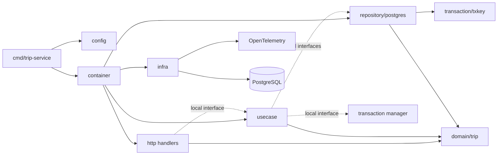
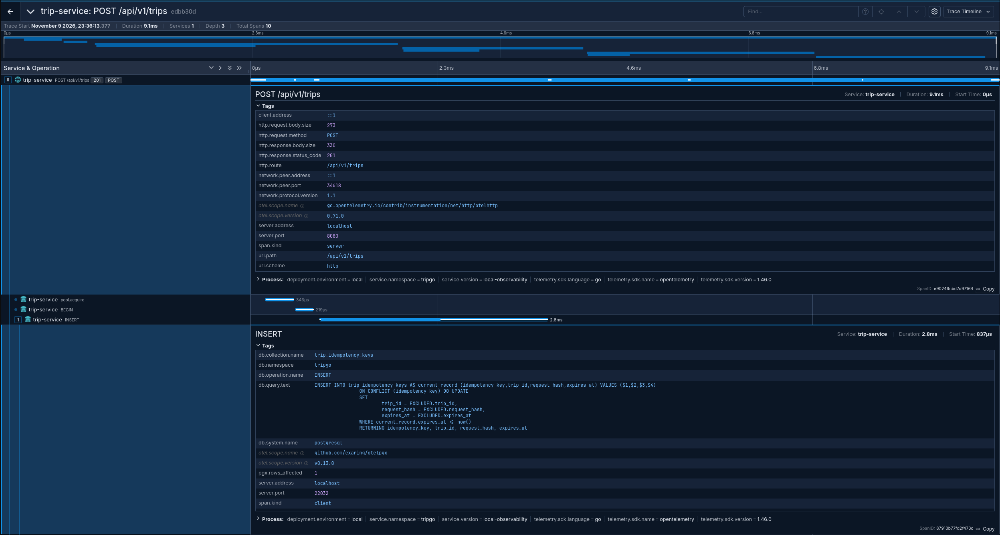
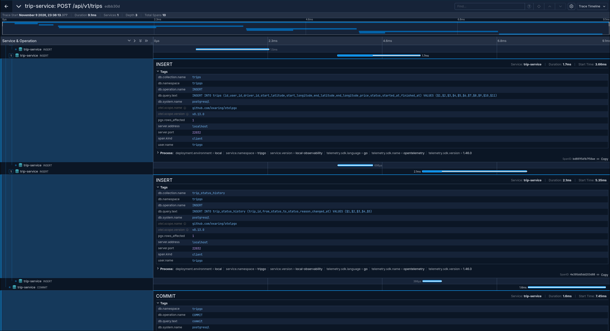
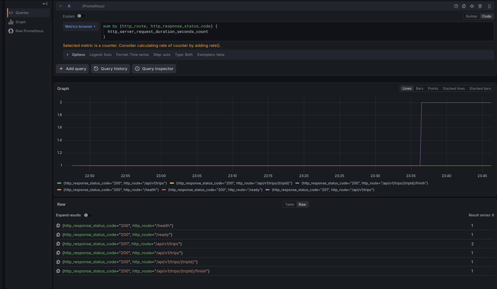
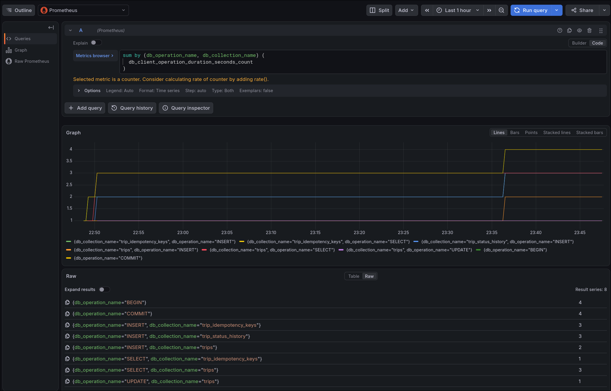
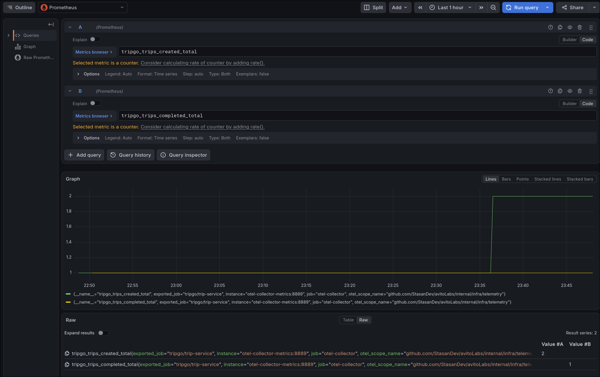

# TripGo — лабораторная работа 2

Во второй лабораторной сервис поездок разделён на слои, покрыт unit- и
интеграционными тестами и инструментирован через OpenTelemetry. HTTP-контракт и
функциональность ЛР1 сохранены: сервис создаёт, возвращает и завершает поездки,
поддерживает идемпотентное создание и хранит историю статусов.

Требования находятся в [задании лабораторной](../../tasks/02-architecture-and-observability/README.md),
а описание HTTP API — в [документации ЛР1](../lab1/README.md).

## Запуск

Нужны Go `1.27.1`, GNU Make, Docker и окружение курса через `tripgoctl`. Все
команды выполняются из корня репозитория.

```bash
tripgoctl cluster start       # один раз на машине
tripgoctl environment start
tripgoctl connect
make migrate
make run SERVICE_VERSION=local
```

`tripgoctl` создаёт локальный `.env`. Настройки и значения для самостоятельного
запуска перечислены в [.env.example](../../.env.example). Адреса Jaeger,
Grafana, Prometheus, PostgreSQL и OTLP endpoint выводит `tripgoctl connect`.

Проверки процесса и доступности PostgreSQL:

```bash
curl -i http://localhost:8080/health
curl -i http://localhost:8080/ready
```

Версия сервиса передаётся при сборке через `SERVICE_VERSION` и попадает в OTel
resource как `service.version`:

```bash
make build SERVICE_VERSION=2.0.0
```

### Конфигурация observability

| Настройка | Назначение |
|---|---|
| `LOG_LEVEL` | Минимальный уровень JSON-логов |
| `OTEL_SERVICE_NAME` | Значение `service.name` |
| `OTEL_EXPORTER_OTLP_ENDPOINT` | Адрес Collector |
| `OTEL_EXPORTER_OTLP_PROTOCOL` | Протокол OTLP exporter |
| `OTEL_RESOURCE_ATTRIBUTES` | Namespace, environment и другие resource attributes |
| `OTEL_TRACES_SAMPLER` | Политика сэмплирования трейсов |
| `OTEL_METRIC_EXPORT_INTERVAL` | Интервал экспорта метрик в миллисекундах |
| `OTEL_METRIC_EXPORT_TIMEOUT` | Таймаут экспорта метрик в миллисекундах |
| `SERVICE_VERSION` | Make/Docker build argument, записываемый через `ldflags` |

## Архитектура



`cmd/trip-service` отвечает за загрузку конфигурации, создание логгера, запуск и
graceful shutdown. Роль composition root выполняет `internal/container`: только
там создаются конкретные репозитории, usecase, HTTP-обработчики и
инфраструктурные зависимости. Такое разделение оставляет `main` коротким и
сохраняет ручную сборку зависимостей без DI-фреймворка.

| Пакет | Ответственность |
|---|---|
| `internal/domain/trip` | Модели, конструкторы, валидация, переходы статусов и доменные ошибки |
| `internal/usecase/trip/{create,get,finish}` | Сценарии приложения и границы транзакций |
| `internal/http/trip/{create,get,finish}` | Разбор и формирование HTTP-запросов и ответов |
| `internal/http/domainerror` | Единый перевод доменных ошибок в HTTP Problem |
| `internal/http/middleware` | OpenAPI validation, Recover, Tracing, Logging и Metrics |
| `internal/repository/postgres/trip` | SQL и преобразование строк PostgreSQL в доменные модели |
| `internal/infra/postgres` | Пул, DB telemetry и менеджер транзакций |
| `internal/infra/telemetry` | JSON-логгер, OTel resource, tracer/meter providers и бизнес-метрики |
| `internal/container` | Создание и связывание конкретных реализаций |
| `internal/generated` | Типы, серверный интерфейс и встроенная OpenAPI-спецификация |

Зависимости направлены к домену. `domain` не импортирует HTTP, PostgreSQL или
OpenTelemetry; `usecase` не зависит от transport и pgx; HTTP-обработчики не
обращаются к репозиториям и инфраструктуре напрямую.

### Интерфейсы

Интерфейсы объявлены на стороне потребителя:

- каждый HTTP-обработчик описывает нужный ему usecase в своём `contract.go`;
- каждый usecase описывает репозитории, transaction manager и recorder в своём
  `contracts.go`;
- реализации репозиториев не публикуют общий широкий интерфейс хранилища.

Так обработчик можно тестировать мок-реализацией usecase, а usecase — моками
репозиториев и менеджера транзакций. Добавление второго транспорта не требует
менять домен и репозитории: новый адаптер вызывает те же usecase через свои
локальные интерфейсы.

## Принятые решения

### Домен и ошибки

Создание `Trip`, `TripStatusHistory` и `IdempotencyRecord` выполняют доменные
конструкторы. Метод `Trip.Finish` инкапсулирует допустимый переход
`active → completed`. Валидация возвращает `ValidationError` с именем поля и
причиной.

Пакет [domainerror](../../internal/http/domainerror/domainerror.go) в одном месте
переводит доменные ошибки, включая обёрнутые через `%w`, в Problem Details:

| Ошибка | HTTP | `code` |
|---|---:|---|
| `ErrTripNotFound` | `404` | `trip_not_found` |
| `ErrTripCompleted` | `409` | `trip_completed` |
| `ErrDriverBusy` | `409` | `driver_busy` |
| `ErrIdempotencyConflict` | `409` | `idempotency_conflict` |
| неизвестная внутренняя ошибка | `500` | `internal_error` |

Внутренняя ошибка логируется, но её текст не попадает в ответ клиенту.

### OpenAPI validation

Источник истины — [OpenAPI-контракт](../../contracts/openapi/trip-service.openapi.yaml).
`make generate` обновляет Go-типы, серверный интерфейс и встроенную
спецификацию. Request validator проверяет обязательные поля, типы, диапазоны и
неизвестные свойства до вызова обработчика. В `400 invalid_request` возвращается
деталь из `SchemaError`, например имя поля и нарушенное ограничение; сам
OpenAPI-контракт для этого не изменяется.

Исходные байты тела сохраняются для SHA-256 idempotency hash. Повтор с тем же
ключом и телом возвращает существующую поездку, а тот же ключ с другим телом —
`409 idempotency_conflict`.

### PostgreSQL и транзакции

Пул создаётся один раз в [infra/postgres/pool](../../internal/infra/postgres/pool/pool.go)
и передаётся репозиториям и transaction manager. Репозитории используют общий
executor: если в контексте есть `pgx.Tx`, запрос выполняется в ней, иначе —
через пул.

Transaction manager помещает транзакцию в контекст, выполняет callback и делает
`COMMIT` только при успехе. При ошибке или панике выполняется `ROLLBACK`.
Поэтому создание поездки вместе с начальной историей и завершение поездки вместе
с новой записью истории атомарны.

### Observability

Сервис создаёт OTel providers до PostgreSQL-пула и экспортирует трейсы и
метрики по OTLP/HTTP. Resource содержит `service.name`, `service.version`,
`service.namespace`, `deployment.environment` и атрибуты SDK. Завершение
providers выполняется после остановки HTTP-сервера и закрытия пула.

Порядок middleware зафиксирован в роутере:

```text
Recover → Tracing → Logging → Metrics → OpenAPI validator → handler
```

- `Recover` перехватывает панику, логирует её со stack trace и возвращает
  `500 internal_error`;
- `Tracing` создаёт HTTP-спан с именем `{method} {http.route}` и отмечает
  `5xx`/panic через `error.type` и `codes.Error`;
- `Logging` после ответа пишет одну запись `request handled`;
- `Metrics` измеряет длительность и количество активных запросов;
- `otelpgx` создаёт DB-спаны на уровне пула, а DB tracer добавляет collection и
  записывает требуемую гистограмму.

Логи формируются `slog.JSONHandler`, пишутся в stdout и фильтруются через
`LOG_LEVEL`. Логгер передаётся зависимостью. Контекстный handler добавляет
`trace_id` и `span_id`, поэтому запись запроса и бизнес-событие можно связать с
тем же трейсом в Jaeger. Тела HTTP-запросов и ответов не логируются.

| Сигнал | Тип | Основные атрибуты |
|---|---|---|
| `http.server.request.duration` | histogram, seconds | method, route, status code |
| `http.server.active_requests` | up-down counter | method, route |
| `db.client.operation.duration` | histogram, seconds | operation, collection, error type |
| `tripgo.trips.created` | counter | — |
| `tripgo.trips.completed` | counter | — |

Бизнес-события `trip created` и `trip completed` записываются только после
успешной транзакции. Идемпотентный replay не увеличивает `tripgo.trips.created`.
Недоступность Collector не влияет на обработку HTTP-запросов; exporter сообщает
об ошибке асинхронно, а сервис продолжает работу.

## Тестирование

- доменные правила и error mapper проверяются table-driven unit-тестами;
- usecase тестируются через `gomock`, включая ошибки репозитория, транзакции,
  историю и все ветки идемпотентности;
- HTTP-обработчики тестируются через `httptest` и моки usecase;
- middleware имеют unit-тесты на logging, tracing и recovery;
- репозитории проверяются на PostgreSQL 16 через `testcontainers-go`;
- интеграционная suite поднимает один контейнер, применяет миграции и очищает
  таблицы перед каждым тестом;
- отдельный сценарий подтверждает rollback записи в две таблицы.

```bash
make lint
make test
make test-integration
```

`make test` запускает тесты с race detector и печатает покрытие `domain` и
`usecase`; текущий итоговый результат — `88.9%`. Интеграционные тесты отделены
build-тегом `integration` и требуют работающий Docker.

## Команды

| Команда | Назначение |
|---|---|
| `make build [SERVICE_VERSION=...]` | Собрать все пакеты и записать версию в бинарник |
| `make run [SERVICE_VERSION=...]` | Запустить сервис |
| `make test` | Unit- и handler-тесты с race detector и отчётом покрытия |
| `make test-integration` | Интеграционные тесты репозиториев |
| `make lint` | Запустить обязательный набор линтеров |
| `make generate` | Обновить OpenAPI-код и gomock-файлы |
| `make migrate` | Применить миграции |
| `make migrate-down` | Откатить последнюю миграцию |
| `make migrate-status` | Показать состояние миграций |

## Результат observability

Один HTTP-трейс связывает создание поездки, резервирование idempotency key,
запись поездки и истории и фиксацию транзакции:





HTTP-метрики используют шаблоны маршрутов, поэтому `tripId` не создаёт
высокую кардинальность:



DB-метрика разделяется по операции и коллекции:



Бизнес-счётчики отражают только успешно зафиксированные изменения:



Для воспроизведения графиков в Grafana Explore использовались запросы:

```promql
sum by (http_route, http_response_status_code) (
  http_server_request_duration_seconds_count
)
```

```promql
sum by (db_operation_name, db_collection_name) (
  db_client_operation_duration_seconds_count
)
```

```promql
tripgo_trips_created_total
tripgo_trips_completed_total
```
